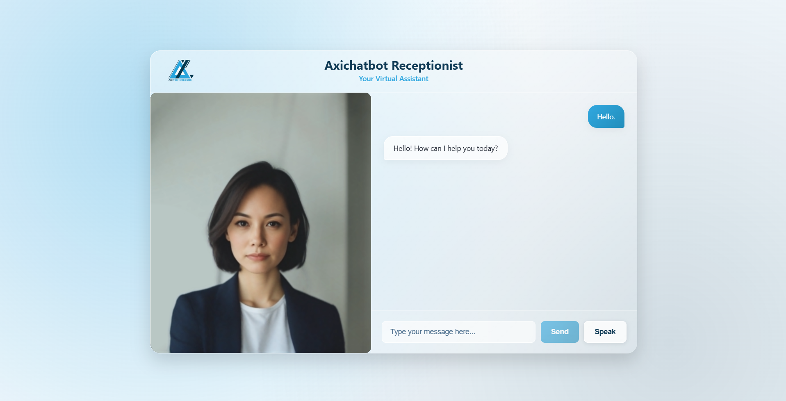

# Axichatbot — AI Video Reception Chatbot

An AI-powered video receptionist that greets visitors, answers questions about the company using real company data, and responds through a photoreal talking avatar with lip-synced speech in **English, Urdu and Roman Urdu**.

## Screenshots

### Avatar & Chat Interface


## Features
- **Text and speech-to-speech conversation** — the avatar speaks every reply, whether the question was typed or spoken
- **Photoreal talking avatar** (Simli) with real-time, audio-driven lip sync; works for Urdu because it animates directly from the generated speech
- **Trilingual: English, Urdu (Nastaliq script) and Roman Urdu** — detected per message; the reply comes back in the same language, in natural Pakistani Urdu
- **Agentic tool routing** — the LLM decides per question whether to search documents (vector DB) or query live data (PostgreSQL), and falls back to documents when the database has no match
- **Hybrid retrieval** — BGE-M3 dense vectors + BM25 sparse vectors fused with Reciprocal Rank Fusion inside Qdrant, optional cross-encoder reranking
- **Structure-aware chunking** — contextual chunk headers, sentence-level overlap, FAQ pairs kept whole, tables split into row groups with the header repeated
- **Low-latency streaming speech** — audio streams to the avatar while it is still being synthesised, over pre-opened TTS connections (~0.5 s to first audio for English)
- **Code-switched pronunciation** — Urdu words and English words inside an Urdu sentence are spoken by two matched voices and stitched together without breaks
- **Professional receptionist persona** — spoken-style answers (no slashes, brackets or abbreviations), honest "I don't have that detail" instead of invented facts
- **Retrieval evaluation** — `eval_retrieval.py` reports Hit@k / MRR / latency for dense vs hybrid vs reranked search
- **Conversation memory** for follow-up questions
- The API also returns the tools used and source sections for every answer (useful for debugging and evaluation)

## Architecture

```
 mic / text ──► Whisper STT ──► language detect (en / ur / roman_ur)
                 (Urdu fix: re-transcribe if Whisper outputs Hindi script)
                                   │
                                   ▼
                  LLM with tools (Groq) ── search_documents ──► Qdrant hybrid search
                   │  language-specific      (query always       dense + BM25 → RRF
                   │  system prompt          translated to EN)   → optional rerank
                   │                    └─ get_employee/project/department ──► PostgreSQL
                   ▼
        answer text (shown immediately)
                   │
                   ▼  POST /tts (streamed)
   speech cleanup ──► Roman Urdu: Urdu words → Urdu script, English words kept
                   │
                   ├─ English reply ──► Azure TTS (Ava) ─────────────────────┐
                   └─ Urdu reply ──► split into Urdu / English segments      │
                                     Urdu → Uzma, English → Neerja           │
                                     parallel, trimmed, stitched ────────────┤
                                                                             ▼
                                                         Simli avatar lip sync (WebRTC)
```

### How Roman Urdu works
1. `language.py` classifies each message: Urdu script by Unicode range, Roman Urdu vs English with a lexicon of Roman Urdu function words (no API needed). Very short messages ("ok") keep the previous language.
2. The system prompt tells the LLM to reply in that language using everyday Pakistani Urdu, but to always write tool arguments **in English**, because the documents and database are English.
3. The screen shows the reply as written. For speech, the Urdu words of a Roman Urdu reply are converted to Urdu script, while English words (*leave, policy, paid vacation, manager*) stay in English letters.

### How the voice pronunciation works
A single Pakistani Urdu voice reads English words with Urdu letter rules ("maternity" → "matarnati", "paid" → "pad"), and a single English voice speaks Urdu with a foreign accent. So Urdu replies use two voices:

- **Urdu words** → `ur-PK-UzmaNeural` (native Pakistani Urdu)
- **English words inside the sentence** → `en-IN-NeerjaNeural` (South Asian English, close to how Pakistanis say English words)

Switching voices inside one Azure request adds ~0.2 s of silence at every switch (17 breaks were measured in one answer). Instead, `speech.py` splits the reply into segments, merges small connector words (*ya, aur*) into the English phrases, synthesises the segments **in parallel on a pool of warm connections**, trims each segment's silent edges and joins them, keeping a short pause only at punctuation. Measured result: 0 breaks inside phrases, and a 13-second answer is ready in about 4 seconds.

Text is also cleaned for speech: slashes become "or" / "ya", time-zone tags like "(PKT)" are dropped, abbreviations such as HR are spelled out ("H R") and emails are read as "name dot surname at domain dot com".

Every spoken reply is logged to `logs/tts_log.jsonl` (shown text vs. the exact text sent to the voice) to make pronunciation issues easy to trace.

## Tech Stack
- **Backend:** FastAPI
- **Frontend:** React + Vite
- **LLM:** `openai/gpt-oss-120b` via Groq API (configurable with `LLM_MODEL`)
- **Speech-to-Text:** Groq Whisper Large v3
- **Text-to-Speech:** Azure Neural TTS, streamed — Urdu: Uzma + Neerja (stitched), English: `en-US-AvaMultilingualNeural`
- **Embeddings:** BGE-M3 (dense) + BM25-style sparse vectors
- **Reranker (optional):** BGE-reranker-v2-m3
- **Vector DB:** Qdrant (Docker), hybrid search with RRF
- **Relational DB:** PostgreSQL (Docker)
- **Avatar & Lip Sync:** Simli (photoreal, audio-driven, streamed over WebRTC)

## Setup

### Prerequisites
- Python 3.11+
- Node.js 18+
- Docker Desktop
- Groq API key — https://console.groq.com/keys
- Simli API key + face ID — https://simli.com (the free plan includes monthly minutes)
- Azure Speech key — portal.azure.com → Create resource → Speech service, pricing tier **Free F0**. With Azure for Students, pick a region your subscription allows (e.g. East Asia) and use the same region in `.env`.

### Backend
```bash
python -m venv venv
venv\Scripts\activate
pip install -r requirements.txt
```

Copy `.env.example` to `.env` and fill in the keys (Groq, PostgreSQL, Simli, Azure Speech). The PostgreSQL user and password must match `docker-compose.yml`.

Start Qdrant and PostgreSQL:
```bash
docker compose up -d
```

Create the tables and sample company data (first time only):
```bash
python seed_data.py
```

Ingest company documents (re-run after changing anything in `sample_docs/`):
```bash
python ingest.py
```

Start the backend:
```bash
python -m uvicorn main:app --port 8000
```

### Frontend
```bash
cd axichatbot-frontend
npm install
npm run dev
```
Open http://localhost:5173 and click once anywhere on the page so the browser allows audio.

### Tests and evaluation
```bash
pip install pytest
python -m pytest tests              # chunking, sparse encoder, language detection, speech text rules

python eval_retrieval.py            # dense vs hybrid vs hybrid+rerank
python eval_retrieval.py --no-rerank
```

## Configuration
All settings live in `.env` (see `.env.example`). Useful optional ones:

| Variable | Default | Purpose |
|---|---|---|
| `LLM_MODEL` | `openai/gpt-oss-120b` | Groq chat model (must support tool calling) |
| `AZURE_VOICE_UR` | `ur-PK-UzmaNeural` | Voice for Urdu words |
| `AZURE_VOICE_UR_ENGLISH` | `en-IN-NeerjaNeural` | Voice for English words inside Urdu replies |
| `AZURE_VOICE_EN` | `en-US-AvaMultilingualNeural` | Voice for English replies |
| `RERANK_ENABLED` | `false` | Cross-encoder reranking (~2.2 GB model download) |
| `RAG_TOP_K` | `3` | Chunks given to the LLM per search |

## Connect to the PostgreSQL Database
```bash
docker exec -it axichatbot-postgres psql -U axiadmin -d axichatbot
```

## Notes
- The `sample_docs/` folder contains placeholder company information. Replace it with your own markdown or PDF files, then re-run `python ingest.py`.
- Avatar rendering and lip sync are handled by Simli; no local avatar model is needed. If Simli can't start (invalid key or no credits left), the avatar panel shows the reason and text chat keeps working.
- `logs/` and `voice_samples/` are local debugging folders and are not committed.
